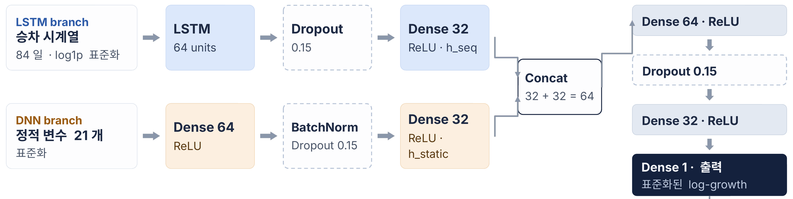
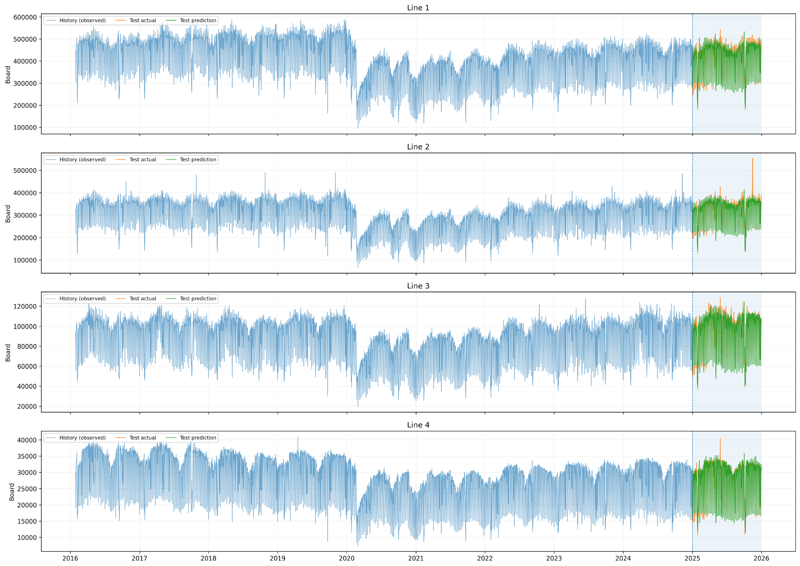
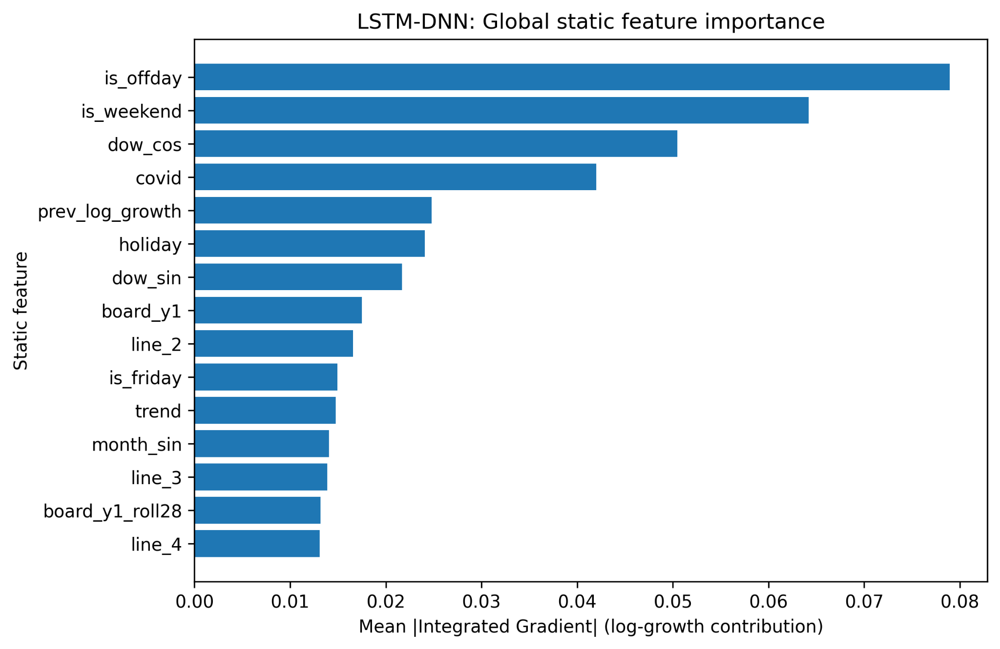
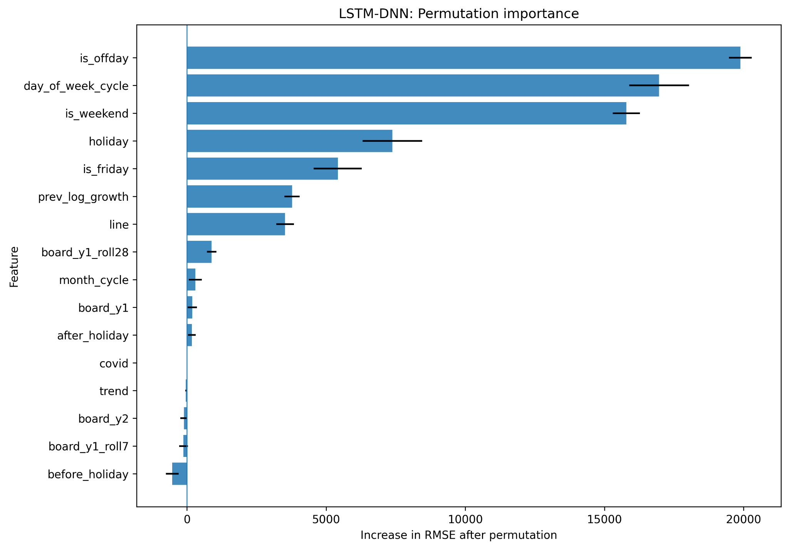
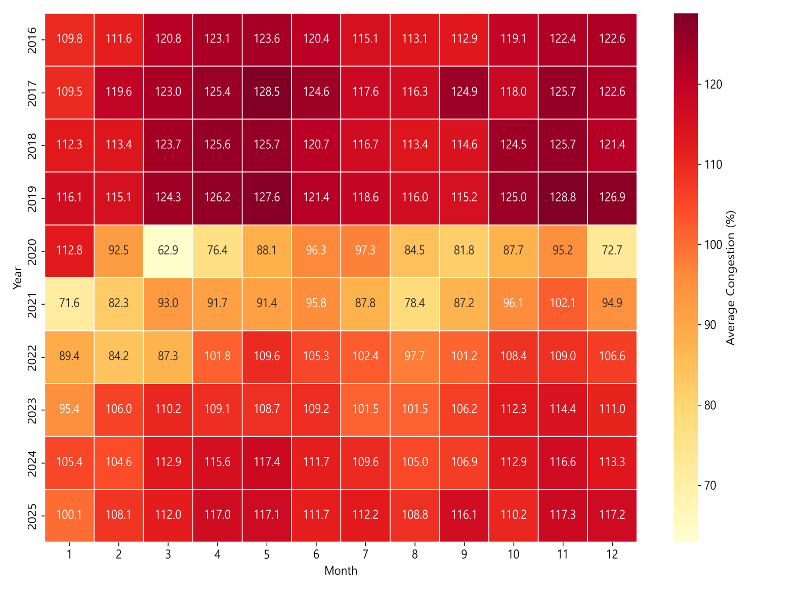
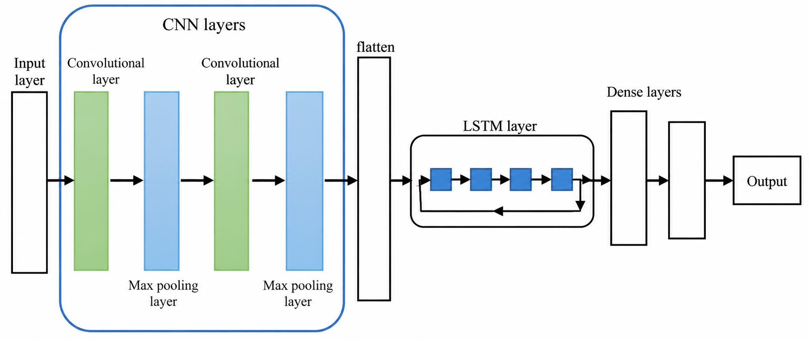
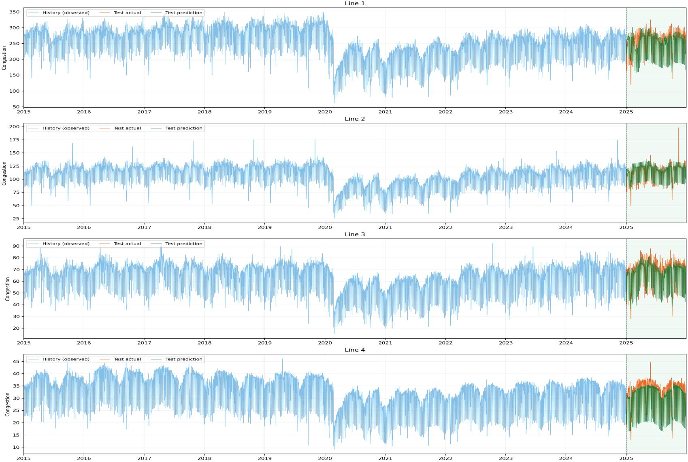
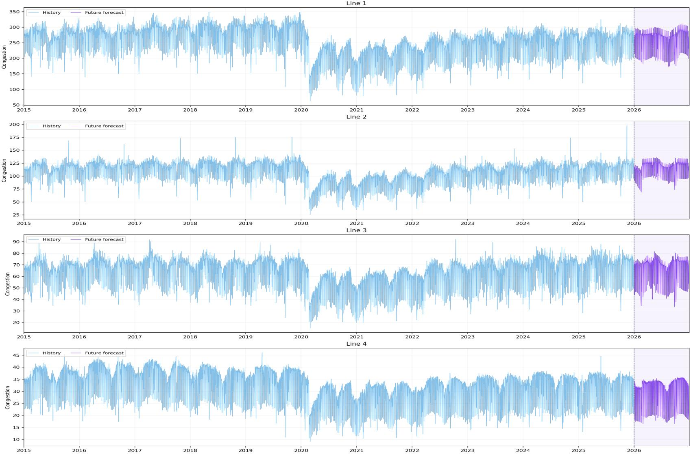

<div align="center">

# 🚇 부산 도시철도 수요 및 혼잡도 예측을 위한 딥러닝 기반 XAI 모델 개발
### Deep Learning-Based Explainable AI (XAI) Models for Forecasting Daily Passenger Demand and Congestion in Busan Metro System

[](https://github.com/yj2da/busan-metro-xai)
[](https://www.python.org/)
[](https://tensorflow.org)
[](https://keras.io)
[](https://opensource.org/licenses/MIT)

<br/>

**오예진¹ · 강고은¹ · 김희영¹ · 이재서² · 정재훈² · 김지훈³ · Vu Tuan Anh⁴ · 하일도³,⁴\***  
*¹국립부경대학교 컴퓨터인공지능공학부, ²통계데이터사이언스전공, ³통계데이터사이언스학과, ⁴인공지능융합학과*  
*(한국데이터정보과학회 학술대회 발표)*

</div>

---

## 📌 Research Overview (연구 개요)

도시철도 승객 수요는 **요일, 공휴일, 계절성, 팬데믹(코로나19) 등 장단기적 패턴 변화에 따라 복잡하게 변동**하여 기존의 전통적 통계 시계열 모형(ARIMA 등)만으로는 비선형적 변동성을 충분히 설명하기 어렵습니다.

본 연구에서는 **부산교통공사 10개년(2016–2025) 도시철도 1~4호선 빅데이터**를 기반으로:
1. **일별 승차수요 예측**: 오차 누적을 방지하는 **전년도 동일 날짜 대비 로그 증감량(Log-Growth)** 타겟과 **LSTM-DNN 하이브리드 전역 모델(Global Model)**을 제안
2. **설명가능한 인공지능 (XAI)**: **Integrated Gradients(IG)** 및 **Permutation Importance(PI)**를 통해 승차수요를 결정짓는 핵심 요인을 정량 규명
3. **일별 혼잡도(Congestion Rate) 지표 수립 및 시계열 예측**: 열차 수송정원 대비 탑승객 수 기반 혼잡도 공식을 정립하고, **CNN-LSTM 시계열 모델**을 통해 2025년 검증 및 **2026년 미래 혼잡도 전망**을 도출하였습니다.

---

## 📊 System Architecture & Key Contributions

### 1. 승차인원 예측 (Subway Boarding Demand Forecasting)

#### 🎯 예측 대상: 전년도 동일 날짜 대비 로그 증감량 (Log-Growth Formulation)
장기 다단계 시계열 예측 시 발생하는 **오차 누적(Error Accumulation)**과 호선별 스케일 차이를 해결하기 위해 승차인원 $Y(t)$를 직접 예측하지 않고, 전년도 동일 날짜 대비 **로그 증감량 $g(t)$**를 예측한 후 지수 복원(Inverse Transform)을 수행합니다.

$$g(t) = \log(1 + Y(t)) - \log(1 + Y(t - 1\text{년}))$$

$$\hat{Y}(t) = \exp\Big\{ \log(1 + Y(t - 1\text{년})) + \hat{g}(t) \Big\} - 1$$

- $Y(t)$: 날짜 $t$의 일별 승차인원
- $t - 1\text{년}$: 전년도 동일 날짜 승차인원
- $\hat{g}(t)$: 모형의 출력을 역표준화한 로그 증감량 예측값

<br/>

#### 🧠 LSTM-DNN 하이브리드 모델 구조
시계열의 동적 연속성을 포착하는 **LSTM Branch**와 캘린더/외생 효과를 처리하는 **DNN Branch**를 결합하고, 부산 도시철도 1–4호선을 단일 전역 신경망(Global Network)으로 통합 학습시켰습니다.

<div align="center">
  
</div>

- **LSTM Branch (동적 시계열 표현)**:
  - 입력: 예측일 1년 전 시점까지의 **84일간 승차 시계열** (호선별 $\log(1+x)$ 변환 및 표준화)
  - 레이어: `LSTM(64 units)` $\rightarrow$ `Dropout(0.15)` $\rightarrow$ `Dense(32, ReLU)` $\rightarrow \mathbf{h}_{\text{seq}}$ (32차원 임베딩)
- **DNN Branch (정적 및 외생 변수 21개)**:
  - 입력: 기저 수요 수준(`board_y1`), 증감 추세(`prev_log_growth`), 달력 변수(비근무일 `is_offday`, 주말 `is_weekend`, 공휴일 `holiday`, 금요일 `is_friday`), 요일·월 삼각함수 순환 인코딩(`dow_sin/cos`, `month_sin/cos`), 코로나19 구간 마스크(`covid`), 장기 추세(`trend`), 호선 One-Hot 인코딩(`line_2, 3, 4`), 이동평균 통계량(`board_y1_roll28` 등)
  - 레이어: `Dense(64, ReLU)` $\rightarrow$ `BatchNorm` $\rightarrow$ `Dropout(0.15)` $\rightarrow$ `Dense(32, ReLU)` $\rightarrow \mathbf{h}_{\text{static}}$ (32차원 임베딩)
- **Feature Concat & Prediction**:
  - 두 브랜치의 임베딩 결합 ($32 + 32 = 64$) $\rightarrow$ `Dense(64, ReLU)` $\rightarrow$ `Dropout(0.15)` $\rightarrow$ `Dense(32, ReLU)` $\rightarrow$ `Dense(1)` (표준화된 log-growth 출력)
  - 최적화: Adam Optimizer, MSE Loss, EarlyStopping (Validation Loss 기준)

<br/>

#### 📈 예측 성능 비교 (2025 Blind Test Benchmark)
- **Train Period**: 2018–2023
- **Validation Period**: 2024 (Lookback 84일 검증 및 하이퍼파라미터 튜닝)
- **Test Period**: 2025 (1개년 블라인드 최종 평가 및 XAI 분석)
- *최종 모형은 2018–2024년 전체 데이터로 재학습 후 2025년 예측 진행*

| Model | RMSE | MAPE (%) | WAPE (%) | $R^2$ |
| :--- | :---: | :---: | :---: | :---: |
| **LSTM-DNN (Ours)** | **18,013** | **5.36%** | **4.73%** | **0.9886** |
| **DNN** | 18,861 | 7.37% | 5.37% | 0.9875 |
| **LSTM** | 36,979 | 12.50% | 10.29% | 0.9520 |
| **ARIMA** | 46,090 | 19.01% | 14.97% | 0.9254 |

**LSTM-DNN 호선별 성능:**
- **1호선:** MAPE **4.74%** / $R^2$ **0.878**
- **2호선:** MAPE **5.15%** / $R^2$ **0.800**
- **3호선:** MAPE **6.12%** / $R^2$ **0.864**
- **4호선:** MAPE **5.43%** / $R^2$ **0.910**

<div align="center">
  
  <p><em>▲ 2016–2025 과거 관측값(파랑), 2025년 실제값(주황), LSTM-DNN 예측값(초록)</em></p>
</div>

---

### 2. 설명가능한 인공지능 (XAI) 정량 분석

블랙박스 신경망의 예측 메커니즘을 규명하기 위해 **경로 적분 기울기(Integrated Gradients)**와 **특성 치환 중요도(Permutation Importance)** 두 가지 XAI 방법론을 병행 적용하였습니다.

#### ① Integrated Gradients (IG; Sundararajan et al., 2017)
기준점(학습 데이터 평균 $\mathbf{x}'=0$)에서 실제 입력 $\mathbf{x}$까지 경로를 따라 기울기를 선적분하여 각 변수의 로그 증감량 기여도를 산출:

$$\text{IG}_i(\mathbf{x}) = (x_i - x'_i) \int_{0}^{1} \frac{\partial F(\mathbf{x}' + \alpha(\mathbf{x} - \mathbf{x}'))}{\partial x_i} d\alpha$$

#### ② Permutation Importance (PI; Breiman, 2001)
테스트 세트에서 특정 변수 $j$를 무작위로 셔플링했을 때 발생하는 RMSE 오차 증가량을 측정:

$$\text{PI}_j = \text{RMSE}(X^{(j)}) - \text{RMSE}(X)$$

<div align="center">
  <table width="100%">
    <tr>
      <td width="50%" align="center"><b>Global Static Feature Importance (IG)</b></td>
      <td width="50%" align="center"><b>Permutation Feature Importance (PI)</b></td>
    </tr>
    <tr>
      <td></td>
      <td></td>
    </tr>
  </table>
</div>

> **💡 XAI 주요 분석 결과:**
> - 두 XAI 기법 모두에서 **비근무일(`is_offday`)**, **요일 주기(`day_of_week_cycle` / `dow_cos`)**, **주말(`is_weekend`)**, **공휴일(`holiday`)** 등 **달력 기반 이동 패턴(Calendar Effects)**이 수요 결정의 최상위 기여 요인으로 도출됨.
> - 직전 연도 증감량(`prev_log_growth`)과 코로나 충격(`covid`) 역시 중장기 수요 변화를 설명하는 핵심 변수로 기능함을 수학적으로 검증.

---

### 3. 혼잡도 지표 정의 및 예측 (Congestion Forecasting)

#### 📐 혼잡도(%) 공식 정립
시간대별 승객 수요를 실제 운행 열차의 총 수송정원으로 나눈 정량 혼잡도 지표 산출:

$$\text{총 수송정원}_{l,t} = N_{l,t} \times C_l$$

$$\text{혼잡도}_{l,t} (\%) = \left(\frac{\text{승객 수요}_{l,t}}{\text{총 수송정원}_{l,t}}\right) \times 100$$

- $N_{l,t}$: 시간대 $t$에 호선 $l$에서 운행한 열차 수 (부산교통공사 열차시각표 기준)
- $C_l$: 호선 $l$의 열차 1편성당 수송정원 (전동차 주요 사양 기준)
  - **1호선:** 970명 (8량 편성)
  - **2호선:** 722명 (6량 편성)
  - **3호선:** 474명 (4량 편성)
  - **4호선:** 316명 (6량 경전철)

<div align="center">
  
  <p><em>▲ 2016–2025 연도·월별 평균 혼잡도 추이 (팬데믹 시기 2019.03 124.3% → 2020.03 62.9%로 급감 후 2025년 100~117% 수준으로 정상 회복)</em></p>
</div>

<br/>

#### 🧬 CNN-LSTM 혼잡도 예측 모형
일별·월별 시계열의 국소적 급변 패턴을 추출하는 **1D-CNN 레이어**와 장기 시계열 의존성을 학습하는 **LSTM 레이어**를 결합한 하이브리드 아키텍처를 구축하였습니다.

<div align="center">
  
</div>

- **구조:** `Input` $\rightarrow$ `Conv1D + MaxPool` $\times 2$ $\rightarrow$ `Flatten` $\rightarrow$ `LSTM` $\rightarrow$ `Dense Layers` $\rightarrow$ `Output (Daily Congestion)`

#### 📊 성능 평가 (2025 Test Benchmark)
기존 단독 LSTM 대비 **모든 호선에서 오차가 유의미하게 감소**하여 CNN-LSTM의 우수성을 입증하였습니다.

| 호선 | LSTM MAE | **CNN-LSTM MAE** | LSTM RMSE | **CNN-LSTM RMSE** |
| :---: | :---: | :---: | :---: | :---: |
| **1호선** | 13.403 | **12.289** *(↓ 1.114)* | 17.331 | **16.623** *(↓ 0.708)* |
| **2호선** | 7.135 | **5.880** *(↓ 1.255)* | 8.923 | **7.623** *(↓ 1.300)* |
| **3호선** | 4.653 | **4.356** *(↓ 0.297)* | 6.576 | **6.107** *(↓ 0.469)* |
| **4호선** | 1.847 | **1.699** *(↓ 0.148)* | 2.209 | **2.082** *(↓ 0.127)* |

<div align="center">
  
  <p><em>▲ 2025년 4개 호선 혼잡도 예측 결과 (실제 관측값과 CNN-LSTM 예측치의 높은 일치도)</em></p>
</div>

<br/>

#### 🔮 2026년 미래 혼잡도 전망 (Future Forecast)
학습된 CNN-LSTM 모형을 바탕으로 **2026년 1월부터 12월까지 호선별 일별 혼잡도를 선제 예측**하였습니다.

<div align="center">
  
  <p><em>▲ 과거 관측값(파랑) 및 2026년 미래 혼잡도 예측값(보라)</em></p>
</div>

- 4개 호선 모두 요일별 출퇴근 첨두 패턴이 규칙적으로 지속될 것으로 전망됨.
- 1·2호선 중심의 고혼잡 상태와 3·4호선의 안정적 운영 수준이 유지될 것으로 예측되어, **수요 응답형 탄력 배차 및 인력 배치 최적화**의 기초 자료로 활용 가능.

---

## 🛠 Tech Stack

- **Deep Learning / ML:** `TensorFlow 2.x`, `Keras`, `Scikit-learn`
- **Time Series & Data:** `Pandas`, `NumPy`, `Statsmodels (ARIMA)`
- **XAI (Explainable AI):** `Integrated Gradients`, `Permutation Importance`
- **Visualization:** `Matplotlib`, `Seaborn`

---

## 📁 Repository Structure

```text
├── docs/
│   └── images/                              # 연구 아키텍처 및 결과 시각화 그래프
│       ├── lstm_dnn_architecture.png
│       ├── boarding_demand_prediction_2025.png
│       ├── xai_integrated_gradients.png
│       ├── xai_permutation_importance.png
│       ├── monthly_congestion_heatmap.png
│       ├── cnn_lstm_architecture.png
│       ├── congestion_prediction_2025.png
│       └── congestion_forecast_2026.png
├── Busan_Metro_Demand_and_Congestion_XAI.ipynb  # 전체 연구 파이프라인 (LSTM-DNN, XAI, CNN-LSTM) 메인 연구 노트북
├── 부산교통공사_승하차_데이터_분석.ipynb          # 공공데이터 전처리 및 기초 통계 분석 노트북
└── README.md
```

---

## 📚 References

1. Box, G. E. P., Jenkins, G. M., Reinsel, G. C. and Ljung, G. M. (2015). *Time Series Analysis: Forecasting and Control* (5th ed.). Wiley.
2. Breiman, L. (2001). Random forests. *Machine Learning*, 45, 5–32.
3. Goodfellow, I., Bengio, Y. and Courville, A. (2016). *Deep Learning*. MIT Press.
4. Hochreiter, S. and Schmidhuber, J. (1997). Long short-term memory. *Neural Computation*, 9, 1735–1780.
5. LeCun, Y., Bottou, L., Bengio, Y. and Haffner, P. (1998). Gradient-based learning applied to document recognition. *Proceedings of the IEEE*, 86, 2278–2324.
6. Sundararajan, M., Taly, A. and Yan, Q. (2017). Axiomatic attribution for deep networks. *Proceedings of the 34th ICML*, 3319–3328.

---

<div align="center">
  <sub>Developed by Yejin Oh & Research Team at Pukyong National University. All rights reserved.</sub>
</div>
