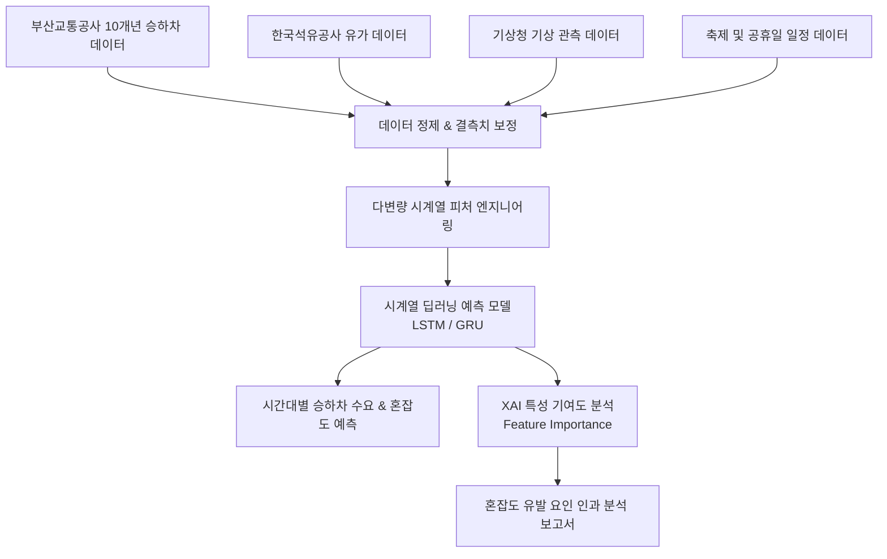

<!--
====================================================================
📌 [GitHub About 설정 가이드]
- Description: 부산 도시철도 10개년 승하차 수요 및 혼잡도 예측 시계열 딥러닝 모델 & XAI 해석 시스템
- Website: (분석 보고서 또는 시각화 링크)
- Topics: deep-learning, time-series, xai, explainable-ai, tensorflow, keras, pandas, urban-data, busan
====================================================================
-->

# 🚇 Busan Metro Ridership & Congestion Forecasting via XAI Deep Learning

<p align="center">
  
  
  
  
</p>

> **부산교통공사 10개년(2016~2025) 도시철도 승하차 공공데이터와 다변량 외생변수(유가, 날씨, 축제 등)를 결합한 시계열 혼잡도 예측 딥러닝 모델 및 XAI(설명 가능한 인공지능) 특성 기여도 해석 시스템**

---

## 📌 Key Highlights

- **10개년 시계열 빅데이터 정제 및 전처리**:
  - 부산교통공사 도시철도 1~4호선 전체 역사의 10개년 승하차 일별/시간대별 데이터 전처리
  - 결측치 보정 및 이상치 정제 파이프라인 구축
- **다변량 외부 변수(Exogenous Variables) 결합**:
  - 한국석유공사 유가 변동 데이터
  - 기상청 기온·강수량·적설량 데이터
  - 공휴일, 요일 및 지역 대형 축제(불꽃축제, 영화제 등) 일정 데이터 통합
- **시계열 딥러닝 예측 모델 구축**:
  - LSTM / GRU / Transformer 기반의 역사별 승하차 승객 수 및 시간대별 혼잡도 예측
- **XAI(설명 가능한 AI) 특성 기여도 분석**:
  - 모델의 예측 결과에 대해 특성 기여도(SHAP / Feature Attribution)를 추출
  - 단순 예측을 넘어 '어떤 외부 요인이 특정 역의 혼잡도를 유발했는지' 인과관계 해석 보고서 도출

---

## 🏗️ Analytics Pipeline



---

## 🛠 Tech Stack

| 구분 | 기술 스택 |
| :--- | :--- |
| **Data Processing** | Python, Pandas, NumPy, Scikit-learn |
| **Deep Learning** | TensorFlow / Keras (LSTM, Time-Series Models) |
| **Interpretability (XAI)** | SHAP, Feature Attribution, Matplotlib, Seaborn |
| **Environment** | Jupyter Notebook, Google Colab |

---

## 📂 Project Structure

```
├── data/                  # 원본 및 전처리된 시계열 데이터셋
├── notebooks/             # EDA 및 단계별 실험 주피터 노트북
│   ├── 01_eda_and_cleaning.ipynb
│   ├── 02_multivariate_feature_engineering.ipynb
│   ├── 03_model_training_and_evaluation.ipynb
│   └── 04_xai_interpretation.ipynb
├── models/                # 학습된 딥러닝 모델 가중치
└── src/                   # 데이터 파이프라인 및 모듈 코드
```

---

## 👩‍💻 Author
* **오예진 (Oh Yejin)** - Data Scientist & AI Engineer  
* Email: [yejin.6642@gmail.com](mailto:yejin.6642@gmail.com) | GitHub: [@yj2da](https://github.com/yj2da)
